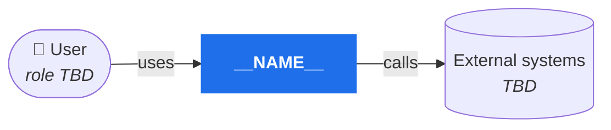

# __NAME__ · Architecture

- **Last updated:** __DATE__
- **Reflects:** no code yet; filled in as this app's specs are planned and built
- **Part of:** the system described in the [root architecture](../../../../docs/architecture/architecture.md)
- **Decisions:** [app ADRs](adr/README.md) · [root ADRs](../../../../docs/architecture/adr/README.md) · **Metrics:** [latest](metrics/latest.md)

> This document describes the inside of the __NAME__ app as it is *now*. What the app reads and writes, and which libraries it uses, is declared at system level in the root [components.json](../../../../docs/architecture/components.json) and shown in the root architecture's system map; don't repeat it here, link to it. Components inside the app come from this folder's [components.json](components.json); the diagrams here must match it.

## 1. Purpose and scope

__TEXT__

_What it deliberately does not do: filled in from the first approved spec._

## 2. Context

Who uses this app, and which shared datasets, libraries and external systems it touches.

## 3. Components

An arrow `A --> B` means "A depends on B". No cycles.

| Component | Responsibility (one sentence) | May depend on | Code location |
|-----------|-------------------------------|---------------|---------------|
| _none yet_ | | | |

## 4. Coupling and modularity

<!-- coupling:begin (generated, do not edit) -->
_No code has been measured yet._
<!-- coupling:end -->

## 5. Key runtime flows

_Sequence diagrams for the flows that matter most._

## 6. Configuration

| Variable | Defined in | Purpose |
|----------|------------|---------|
| _Base variables come from the root `.env.example`; list here only what this app adds or overrides._ | | |
